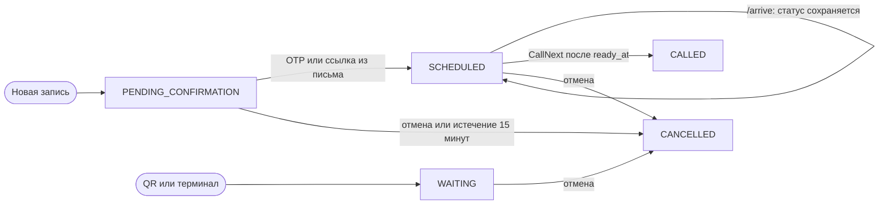
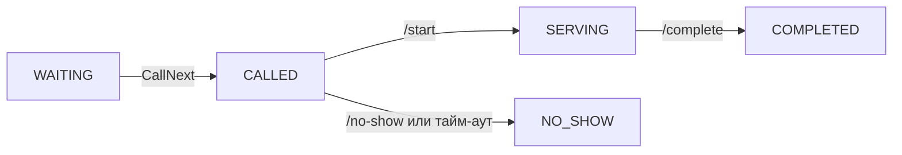
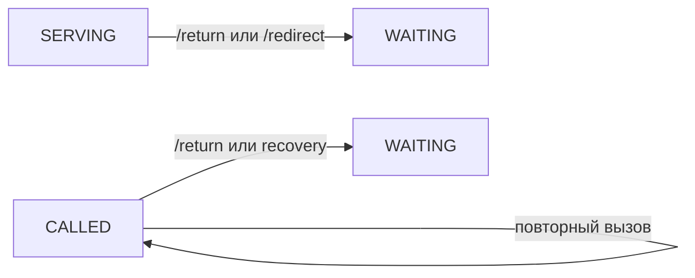

# Алгоритм очереди и конечный автомат талона

Этот документ описывает текущее поведение backend. Канонические реализации:

- допустимые переходы статусов — [`backend/internal/domain/fsm.go`](../backend/internal/domain/fsm.go);
- расчёт `due_at`, `ready_at` и `source_rank` — [`backend/internal/domain/queue_schedule.go`](../backend/internal/domain/queue_schedule.go);
- транзакционный выбор следующего талона — [`backend/internal/persistence/postgres.go`](../backend/internal/persistence/postgres.go);
- расчёт ETA — [`backend/internal/persistence/eta.go`](../backend/internal/persistence/eta.go).

## 1. Ступенчатое ранжирование очереди (Tiered Queue Priority)

Взамен числовых весов и квот действует детерминированная система трёх уровней приоритета со ступенчатым старением:

| Уровень | Обозначение | Описание |
|---|---|---|
| **Tier 0** | `APPOINTMENT` | Предварительная запись в своё время слота или повышенный талон |
| **Tier 1** | `QR` | Талон по QR / с сайта или талон LIVE / опоздавшая запись после первого повышения |
| **Tier 2** | `LIVE` | Талон из терминала зала или талон раннего прихода по записи |

Администратор отделения настраивает:
- **Интервал повышения $T$**: строго `10`, `15` или `20` минут (`anti_starvation_threshold_minutes`).
- **Льготное опоздание записи**: строго `5`, `10` или `15` минут (`appointment_grace_minutes`).

Любые изменения настроек политики очереди сохраняются с отложенной активацией на следующий локальный календарный день отделения.

### Правила перехода между уровнями:
1. **Предварительная запись (`APPOINTMENT`)**:
   - До времени слота талон не участвует в автоматическом вызове. В момент слота он сразу получает уровень `APPOINTMENT` (Tier 0).
   - Если клиент не вызван в течение льготного периода (`slot + grace`), запись временно переходит на уровень `QR` (Tier 1).
   - Через $T$ минут нахождения в Tier 1 талон снова возвращается на верхний уровень `APPOINTMENT` (Tier 0).
2. **Ранний приход по записи**:
   - Если клиент нажимает кнопку «Я в отделении раньше времени» строго до слота (`arrived_at < scheduled_at`), он добровольно и необратимо переходит в живую очередь и начинает старение как `LIVE` (Tier 2 $\to$ Tier 1 $\to$ Tier 0).
3. **Талон по QR (`QR`)**:
   - Начинает на уровне `QR` (Tier 1), через $T$ минут переходит на уровень `APPOINTMENT` (Tier 0).
4. **Талон из зала (`LIVE`)**:
   - Начинает на уровне `LIVE` (Tier 2), через $T$ минут переходит на `QR` (Tier 1), ещё через $T$ минут — на `APPOINTMENT` (Tier 0).
5. **Возврат / перевод талона**:
   - Переведённый или возвращённый талон (`requeued_at IS NOT NULL`) начинает отсчёт старения от времени `requeued_at`.

### Канонический ключ сортировки

Автоматический вызов `CallNext` упорядочивает кандидатов лексикографически:

$$
\mathcal{V}(t) = \big(\text{effective\_tier}(t),\ \text{tier\_entered\_at}(t),\ \text{created\_at}(t),\ \text{id}(t)\big)
$$

1. `effective_tier ASC` — 0 (APPOINTMENT), 1 (QR), 2 (LIVE).
2. `tier_entered_at ASC` — время входа в текущий уровень (FIFO внутри уровня).
3. `created_at ASC` — время создания талона.
4. `id ASC` — UUID талона для полной детерминированности.

### Транзакционный выбор кандидата

Ниже приведён канонический фрагмент запроса `CallNext`:

```sql
SELECT t.*
FROM tickets t
CROSS JOIN LATERAL (
    SELECT ... AS effective_tier, ... AS tier_entered_at
) k
WHERE t.branch_id = $1::uuid
  AND (t.window_id IS NULL OR t.window_id = $2::uuid)
  AND EXISTS (
      SELECT 1
      FROM window_services ws
      WHERE ws.window_id = $2::uuid
        AND ws.service_id = t.service_id
  )
  AND (
      t.status = 'WAITING'
      OR (t.source = 'APPOINTMENT' AND t.status = 'SCHEDULED' AND (t.arrived_at IS NOT NULL OR t.scheduled_at <= $3::timestamptz))
  )
ORDER BY
  k.effective_tier ASC,
  k.tier_entered_at ASC,
  t.created_at ASC,
  t.id ASC
LIMIT 1
FOR NO KEY UPDATE OF t SKIP LOCKED;
```

`SKIP LOCKED` гарантирует, что талон не будет параллельно захвачен другим окном. Очередь и операторский интерфейс используют то же выражение для единого источника истины.

## 2. Конечный автомат талона

Один большой граф скрывал различие между подтверждением записи и обслуживанием, а возвратные стрелки пересекали основной путь. Поэтому жизненный цикл разделён на два небольших графа.

### Создание и допуск в очередь



`/arrive` фиксирует `arrived_at` и `checkin_at`, пересчитывает `ready_at`, `due_at`, `source_rank`, но сохраняет статус `SCHEDULED`. Подтверждённая запись без ручного чекина становится кандидатом `CallNext` в момент `ready_at = scheduled_at`.

### Вызов и обслуживание



Возвратные операции показаны отдельно, чтобы не перекрещивать основной путь:



### Полная матрица переходов

Матрица ниже соответствует `domain.AllowedTransitions`:

| Из статуса | Допустимые следующие статусы |
|---|---|
| создание | `PENDING_CONFIRMATION`, `SCHEDULED`, `WAITING` |
| `PENDING_CONFIRMATION` | `SCHEDULED`, `CANCELLED` |
| `SCHEDULED` | `SCHEDULED`, `WAITING`, `CALLED`, `CANCELLED` |
| `WAITING` | `CALLED`, `CANCELLED` |
| `CALLED` | `CALLED`, `SERVING`, `WAITING`, `NO_SHOW` |
| `SERVING` | `COMPLETED`, `WAITING` |
| `COMPLETED` | — |
| `CANCELLED` | — |
| `NO_SHOW` | — |

Самопереход `SCHEDULED → SCHEDULED` используется при фиксации прибытия без смены пользовательского статуса, а `CALLED → CALLED` — при повторном вызове. `ARRIVED`, `RETURNED` и `REDIRECTED` — события истории, не дополнительные статусы FSM.

## 3. Расчёт ETA

Реализация находится в [`backend/internal/persistence/eta.go`](../backend/internal/persistence/eta.go).

1. Из последних 20 завершённых талонов той же услуги берутся длительности обслуживания не более двух часов.
2. Базовая оценка — линейно взвешенное среднее: самый свежий результат получает вес `N`, самый старый — вес `1`. Это не экспоненциальное сглаживание.
3. При количестве образцов меньше трёх используется fallback `300` секунд.
4. Для каждого открытого совместимого окна моделируется ближайшее время освобождения. Талоны впереди распределяются по окнам дискретной симуляцией.
5. Итоговое ожидание ограничивается диапазоном от 60 до 1800 секунд. ML, если включён, меняет только оценку длительности услуги; порядок очереди остаётся детерминированным.

## 4. Transactional Outbox

Реализация: [`backend/internal/persistence/notification_outbox.go`](../backend/internal/persistence/notification_outbox.go) и [`backend/internal/notification/worker.go`](../backend/internal/notification/worker.go).

1. Изменение состояния талона и запись уведомления выполняются в одной транзакции PostgreSQL.
2. Воркер забирает сообщения с блокировкой `FOR UPDATE SKIP LOCKED`.
3. После неудачи задержка равна `initial_backoff × 2^(attempts−1)` и ограничена множителем `16`. Текущая реализация не добавляет случайный jitter.
4. Ошибка внешнего провайдера не откатывает операцию с талоном; после исчерпания попыток уведомление помечается окончательно неуспешным.

Первое письмо с кодом подтверждения предварительной записи отправляется отдельной фоновой goroutine HTTP-слоя, без transactional outbox. Поэтому оно не обладает outbox-гарантией и при остановке процесса до завершения отправки может потеряться; повторная отправка выполняется отдельным endpoint.
