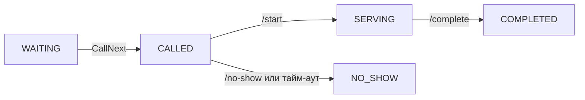
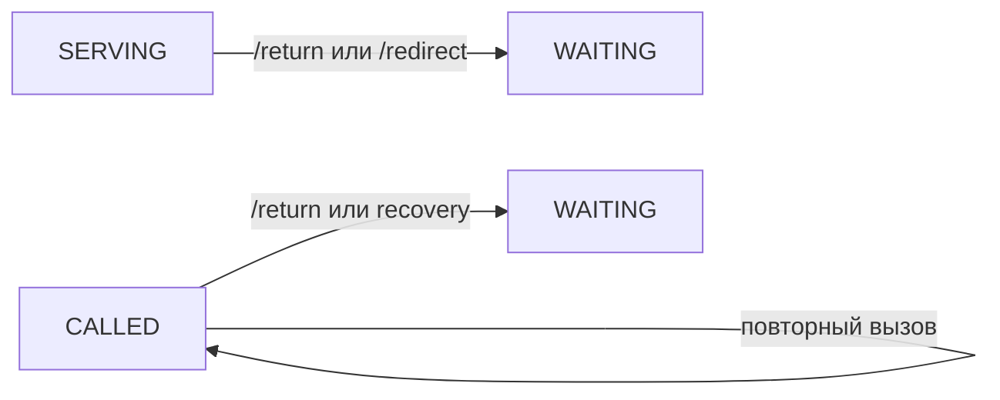

# Алгоритм очереди и конечный автомат талона

Этот документ описывает текущее поведение backend. Канонические реализации:

- допустимые переходы статусов — [`backend/internal/domain/fsm.go`](../backend/internal/domain/fsm.go);
- расчёт `due_at`, `ready_at` и `source_rank` — [`backend/internal/domain/queue_schedule.go`](../backend/internal/domain/queue_schedule.go);
- транзакционный выбор следующего талона — [`backend/internal/persistence/postgres.go`](../backend/internal/persistence/postgres.go);
- расчёт ETA — [`backend/internal/persistence/eta.go`](../backend/internal/persistence/eta.go).

## 1. Ранжирование очереди

`ComputeSchedule` — чистая функция расчёта полей очереди. Сам `CallNext` не является чистой функцией: он выбирает и блокирует кандидата внутри транзакции PostgreSQL.

### Ключ сортировки

Кандидаты сортируются лексикографически:

$$
\mathcal{V}(t) = \big(\text{due\_at}(t),\ \text{effective\_source\_rank}(t),\ \text{checkin\_at}(t),\ \text{id}(t)\big)
$$

1. `due_at ASC` — первым рассматривается талон с более ранним расчётным дедлайном.
2. `effective_source_rank ASC` — при равном дедлайне используется ранг источника. Для неподтверждённого прибытия на запись с опозданием более 30 минут `CallNext` временно использует ранг `2`.
3. `checkin_at ASC` — раньше отметившийся клиент идёт первым.
4. `id ASC` — детерминированный порядок при полном совпадении остальных полей.

Значения по умолчанию из [`queue_policy.yaml`](../queue_policy.yaml):

| Источник | Код | `source_rank` | Назначение |
|---|---|---:|---|
| Предварительная запись | `APPOINTMENT` | 0 | Запись на выбранный слот |
| Талон по QR | `QR` | 1 | Талон со смартфона в отделении |
| Терминал | `LIVE` | 2 | Талон из терминала в зале |

`RETURNED` и `REDIRECTED` не являются источниками талона. Это типы событий аудита; после возврата или перенаправления статус талона становится `WAITING`, а параметры очереди пересчитываются.

### Расчёт расписания

Для `QR` и `LIVE`:

$$
\text{ready\_at}=t_{checkin}, \qquad
\text{due\_at}=t_{checkin}+\Delta t_{max\_wait}
$$

Для `APPOINTMENT` без чекина:

$$
\text{ready\_at}=\text{due\_at}=t_{scheduled}, \qquad
\text{source\_rank}=0
$$

После `/arrive` расчёт зависит от времени прибытия:

| Прибытие | `ready_at` | `due_at` | Ранг |
|---|---|---|---:|
| Раньше `slot − 15 мин` | `checkin_at` | `checkin_at + max_wait(LIVE)` | 2 |
| От `slot − 15 мин` до `slot + 30 мин` включительно | `checkin_at` | `scheduled_at` | 0 |
| Позже `slot + 30 мин` | `checkin_at` | `checkin_at + max_wait(LIVE) + late_penalty` | 2 |

Числа 15 и 30 задаются параметрами `appointment.early_window_minutes` и `appointment.grace_minutes`, а не зашиты в UI.

### Транзакционный выбор кандидата

Ниже приведён сокращённый, но семантически эквивалентный фрагмент запроса `CallNext`:

```sql
SELECT t.*
FROM tickets t
WHERE t.branch_id = $1::uuid
  AND (t.window_id IS NULL OR t.window_id = $2::uuid)
  AND EXISTS (
      SELECT 1
      FROM window_services ws
      WHERE ws.window_id = $2::uuid
        AND ws.service_id = t.service_id
  )
  AND (
      t.status = 'WAITING'
      OR (t.source = 'APPOINTMENT' AND t.status = 'SCHEDULED')
  )
  AND t.ready_at <= $3::timestamptz
ORDER BY
  t.due_at ASC,
  CASE
    WHEN t.source = 'APPOINTMENT'
      AND t.arrived_at IS NULL
      AND t.scheduled_at < $3::timestamptz - INTERVAL '30 minutes'
    THEN 2
    ELSE t.source_rank
  END ASC,
  t.checkin_at ASC,
  t.id ASC
LIMIT 1
FOR NO KEY UPDATE OF t SKIP LOCKED;
```

`SKIP LOCKED` не позволяет двум окнам одновременно получить один талон. `FOR NO KEY UPDATE` соответствует блокировке в рабочем запросе.

## 2. Конечный автомат талона

Один большой граф скрывал различие между подтверждением записи и обслуживанием, а возвратные стрелки пересекали основной путь. Поэтому жизненный цикл разделён на два небольших графа.

### Создание и допуск в очередь


`/arrive` фиксирует `arrived_at` и `checkin_at`, пересчитывает `ready_at`, `due_at`, `source_rank`, но сохраняет статус `SCHEDULED`. Подтверждённая запись без ручного чекина становится кандидатом `CallNext` в момент `ready_at = scheduled_at`.

### Вызов и обслуживание



Возвратные операции показаны отдельно, чтобы не перекрещивать основной путь:



### Полная матрица переходов

Матрица ниже соответствует `domain.AllowedTransitions`:

| Из статуса | Допустимые следующие статусы |
|---|---|
| создание | `PENDING_CONFIRMATION`, `SCHEDULED`, `WAITING` |
| `PENDING_CONFIRMATION` | `SCHEDULED`, `CANCELLED` |
| `SCHEDULED` | `SCHEDULED`, `WAITING`, `CALLED`, `CANCELLED` |
| `WAITING` | `CALLED`, `CANCELLED` |
| `CALLED` | `CALLED`, `SERVING`, `WAITING`, `NO_SHOW` |
| `SERVING` | `COMPLETED`, `WAITING` |
| `COMPLETED` | — |
| `CANCELLED` | — |
| `NO_SHOW` | — |

Самопереход `SCHEDULED → SCHEDULED` используется при фиксации прибытия без смены пользовательского статуса, а `CALLED → CALLED` — при повторном вызове. `ARRIVED`, `RETURNED` и `REDIRECTED` — события истории, не дополнительные статусы FSM.

## 3. Расчёт ETA

Реализация находится в [`backend/internal/persistence/eta.go`](../backend/internal/persistence/eta.go).

1. Из последних 20 завершённых талонов той же услуги берутся длительности обслуживания не более двух часов.
2. Базовая оценка — линейно взвешенное среднее: самый свежий результат получает вес `N`, самый старый — вес `1`. Это не экспоненциальное сглаживание.
3. При количестве образцов меньше трёх используется fallback `300` секунд.
4. Для каждого открытого совместимого окна моделируется ближайшее время освобождения. Талоны впереди распределяются по окнам дискретной симуляцией.
5. Итоговое ожидание ограничивается диапазоном от 60 до 1800 секунд. ML, если включён, меняет только оценку длительности услуги; порядок очереди остаётся детерминированным.

## 4. Transactional Outbox

Реализация: [`backend/internal/persistence/notification_outbox.go`](../backend/internal/persistence/notification_outbox.go) и [`backend/internal/notification/worker.go`](../backend/internal/notification/worker.go).

1. Изменение состояния талона и запись уведомления выполняются в одной транзакции PostgreSQL.
2. Воркер забирает сообщения с блокировкой `FOR UPDATE SKIP LOCKED`.
3. После неудачи задержка равна `initial_backoff × 2^(attempts−1)` и ограничена множителем `16`. Текущая реализация не добавляет случайный jitter.
4. Ошибка внешнего провайдера не откатывает операцию с талоном; после исчерпания попыток уведомление помечается окончательно неуспешным.

Первое письмо с кодом подтверждения предварительной записи отправляется отдельной фоновой goroutine HTTP-слоя, без transactional outbox. Поэтому оно не обладает outbox-гарантией и при остановке процесса до завершения отправки может потеряться; повторная отправка выполняется отдельным endpoint.
